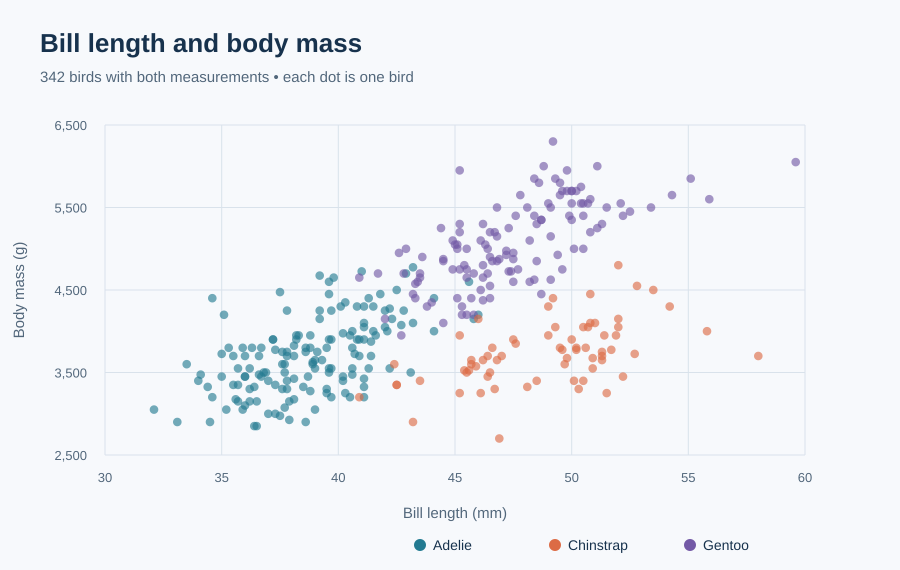

# LIU ZIHAN

I am a data science student interested in using transparent analysis and readable visuals to answer focused questions. This portfolio presents a reproducible exploration of a public ecological dataset.

**Technical skills:** Python, CSV data cleaning, descriptive statistics, SVG data visualization, Git, GitHub Pages, and reproducible documentation.

## Featured project: Palmer Penguins body size

**Research question:** How do body mass and bill length vary among Adélie, Chinstrap, and Gentoo penguins in the Palmer Archipelago sample?

Gentoo penguins have the highest average measured body mass in this sample (**5,076 g**, 123 birds). Adélie and Chinstrap averages are close to one another (**3,701 g** and **3,733 g**). The whiskers show one standard deviation. These descriptive results do not establish why the species differ.

The scatter plot shows individual variation and overlap that a mean alone cannot show. It includes 342 birds with both measurements.

**Project status:** Completed initial descriptive analysis; further analysis of sex, island, and year is planned.

**Project code, data source, limitations, and reproduction steps:** [View the project repository](https://github.com/han-tech123/data-science-project).

The data come from the [palmerpenguins project](https://github.com/allisonhorst/palmerpenguins), which describes its usage permissions and source citations. This is a sample from selected islands and years, so the findings do not describe all penguins.
